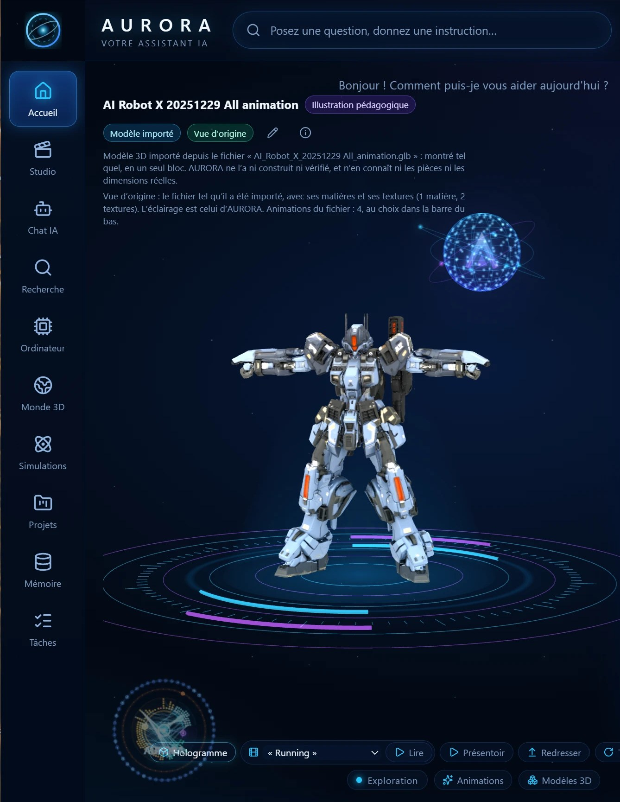
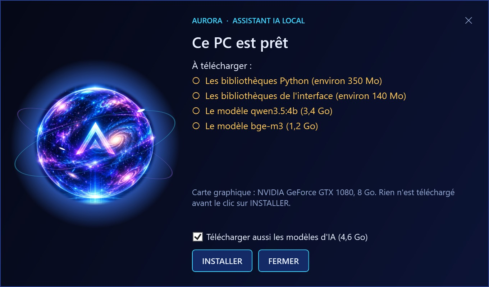

<h1 align="center">AURORA</h1>

<b>Un assistant IA personnel qui tourne sur votre PC.</b> 
Il mesure avant de répondre, garde vos données chez vous, et n'agit qu'après votre accord.

<a href="#installer"><b>Installer AURORA</b></a> ·
<a href="#ce-quelle-sait-faire">Ce qu'elle sait faire</a> ·
<a href="docs/GUIDE.md">Guide complet</a> ·
<a href="#english">English</a>

> **Version alpha.** AURORA fonctionne, mais elle est encore jeune : elle n'a été installée que sur deux PC de
> son auteur, et des choses vont changer. Ses limites sont écrites plus bas, sans rien cacher.
> **Votre avis aide à l'améliorer** : [donner votre avis](#donner-votre-avis).

## Sommaire

- [Ce qui la distingue](#ce-qui-la-distingue)
- [Ce qu'elle sait faire](#ce-quelle-sait-faire)
- [Captures](#captures)
- [Il faut](#il-faut)
- [Installer](#installer)
- [Ce qui va sur Internet](#ce-qui-va-sur-internet)
- [Limites connues](#limites-connues)
- [Donner votre avis](#donner-votre-avis)
- [Qui l'a faite](#qui-la-faite)
- [Crédits et licences](#crédits-et-licences)

## Ce qui la distingue

**Ce qui se mesure ne se génère pas.** La mémoire vive, l'heure, un calcul ou la météo viennent toujours d'un
outil, jamais du modèle de langage. Le reste est rédigé par un modèle local, sur votre carte graphique. Chaque
réponse dit d'où elle vient : **Mesuré**, **Source**, **Mémoire** ou **Modèle seul**.

| Relevé dans le projet | Résultat |
|---|---|
| Demandes comprises sans IA, par des règles (24/11/2026) | **317 phrases sur 332**, en 0,31 ms |
| Réponse par un outil : état du PC, calcul, heure (22/11/2026) | **0,3 seconde** |
| Réponse rédigée par le modèle local, carte de 12 Go (22/11/2026) | 4,5 secondes en moyenne |
| Essais automatiques (24/11/2026) | **1 309, tous réussis** |
| Installation complète sur un second PC, sans aide (24/11/2026) | 2 min 25 s |

- **Local d'abord.** Le modèle local répond toujours en premier. Claude, dans le cloud, n'est qu'un secours
  facultatif : AURORA montre le texte exact qui partirait, et attend votre accord.
- **Aucune action sans accord.** Arrêter un programme, lancer une commande, déplacer un fichier : une carte
  montre ce qui sera fait, puis attend votre oui.
- **Un document n'est jamais une consigne.** Le contenu d'une page web ou d'un fichier est traité comme une
  donnée.

## Ce qu'elle sait faire

| | |
|---|---|
| **Ordinateur** | Elle mesure le processeur, la mémoire, les disques et la carte graphique, fait un diagnostic « mon PC est lent », et arrête un programme avec votre accord. |
| **Conversation et mémoire** | Elle retient ce que vous lui apprenez et retrouve une conversation passée. Tout reste sur le PC. |
| **Documents et images** | Elle lit et résume un texte, un PDF ou un fichier Word ; un PDF scanné est lu par un modèle de vision local. Elle décrit une image, ou une capture d'écran faite sur votre clic. |
| **Agent** | Elle mène une tâche en plusieurs étapes, un outil à la fois, six tours au plus. |
| **Voix** | Vous lui parlez, elle lit ses réponses avec une voix calculée sur le PC (facultative). |
| **Recherche et actualités** | Recherche web avec ses sources, actualités du monde ou d'un pays, actualités scientifiques. |
| **Monde 3D** | Un globe en hologramme : météo, séismes et catastrophes, avions, satellites. Les données en direct sont éteintes tant que vous ne les allumez pas. |
| **Laboratoire 3D** | Trois maquettes livrées (bras robotique, fusée à deux étages, X-SWING), une maquette construite sur demande, un modèle STL, GLB ou OBJ que vous donnez, ou une forme refaite à partir d'une photo. Des illustrations, jamais des simulations. |
| **Projets** | Le dossier d'un projet de conception, avec sa fiche technique interactive. Un projet d'exemple est livré. |
| **Routines et rappels** | Une suite de demandes lancée par son nom ou à une heure ; rappels, minuteurs et réveils. |
| **Actions sur le PC** | Terminal avec autorisation, applications de votre liste, souris et clavier : désactivés au départ, un geste à la fois, toujours après accord. |

Le détail de chaque module est dans le [guide complet](docs/GUIDE.md).

## Captures

Captures de l'application réelle.

## Il faut

| | Essayé avec |
|---|---|
| Système | Windows 11, 64 bits |
| Carte graphique | 8 Go (NVIDIA GTX 1080) et 12 Go (AMD RX 6750 XT) de mémoire vidéo |
| Mémoire vive | 8 Go au moins ; 16 Go ou plus conseillés |
| Disque | 12 Go libres |
| Internet | pendant l'installation |

Avec moins de 10 Go de mémoire vidéo, l'installation prend le modèle `qwen3.5:4b` (3,4 Go) et AURORA s'en sert
sans réglage. Au-dessus, elle prend `qwen3.5:9b` (6,6 Go).

## Installer

1. Ouvrez la [dernière version](../../releases/latest) et téléchargez son fichier **AURORA-….zip**
   (ou, sur cette page : bouton vert **Code**, puis **Download ZIP**).
2. Décompressez-le dans un dossier au nom court, par exemple `C:\AURORA`.
3. Double-cliquez sur **INSTALLER.bat**. Une fenêtre vérifie le PC sans rien changer, puis montre ce qui sera
   téléchargé. Rien n'est téléchargé avant le clic sur « INSTALLER ». Elle prend alors :
   - Python 3.11.7, Node.js 22.23.3 et Ollama 0.35.0 s'ils manquent, chez leurs éditeurs, en vérifiant
     l'empreinte de chaque fichier ;
   - les bibliothèques (environ 500 Mo en tout) ;
   - les modèles d'IA, choisis d'après votre carte graphique (4,6 Go ou 11 Go).
4. Double-cliquez sur l'icône **AURORA** posée sur le Bureau.

Pour arrêter : `AURORA-arreter.bat`, dans le dossier. L'installation à la main, étape par étape, est décrite dans
le [guide complet](docs/GUIDE.md#installation-windows).

## Ce qui va sur Internet

Après l'installation, la conversation, la mémoire et vos fichiers restent sur votre PC. Ce qui sort, seulement
quand vous le demandez ou l'allumez :

- la recherche web, la météo et les actualités, quand vous les demandez ;
- le direct du globe (météo, séismes, avions, satellites), éteint au départ ;
- le trafic aérien mondial (OpenSky Network), éteint au départ : ce service est réservé à la recherche et à
  l'enseignement sans but lucratif, et c'est vous qui l'allumez dans Paramètres ;
- Claude, seulement si vous donnez une clé et acceptez chaque envoi ; le mode **Privé** coupe tout appel au cloud.

Le service d'AURORA n'écoute que sur votre PC (`127.0.0.1`), avec un jeton secret, et les clés sont rangées dans
le coffre de Windows.

## Limites connues

- Windows seulement, et interface en français seulement.
- Installée sur deux PC de son auteur : aucun retour d'autres utilisateurs.
- L'installation de Node.js et d'Ollama par l'installateur n'a jamais tourné : sur les deux PC, ils étaient déjà là.
- Jamais essayés en vrai : les gestes de souris et de clavier (essayés sur un faux Windows), et le démarrage avec
  Windows sur une vraie ouverture de session.
- Trois tours sur quatorze du banc de conversation échouent encore, quel que soit le modèle.
- Pas d'application de bureau : AURORA s'ouvre dans une fenêtre du navigateur (Edge ou Chrome).

## Donner votre avis

AURORA est en version alpha : chaque retour aide à l'améliorer. Après l'avoir essayée, dites ce qui marche, ce qui
coince et ce qui vous manque :

- **un problème ou une idée** : ouvrez une [« issue » sur GitHub](https://github.com/idstudioia/aurora-ia-hybride/issues/new).
  Pour un problème, dites ce que vous avez fait, ce que vous attendiez et ce qui s'est passé, avec votre PC
  (version de Windows, carte graphique, mémoire vive) ;
- **une question, ou simplement en parler** : sur le [Discord d'ID Studio IA](https://discord.gg/NquWmqwH6c).

Les issues sont publiques : n'y mettez jamais de clé, de mot de passe ni de donnée personnelle.

## Qui l'a faite

| Qui | Rôle |
|---|---|
| **[ID Studio IA](https://github.com/idstudioia)** | conception, choix, essais réels sur PC, décisions |
| **[Claude Code](https://claude.com/claude-code)** (Anthropic) | assistant de programmation : écriture du code, essais, bancs de mesure |

ID Studio IA est aussi l'auteur d'[Athéna Local IA](https://github.com/idstudio-athena/athena-local-ia), dont
AURORA reprend plusieurs idées (le globe, la voix, la vision).

## Crédits et licences

AURORA est un logiciel libre, sous licence **GNU AGPL, version 3** : [`LICENSE`](LICENSE). Copyright 2026
ID Studio IA. Chacun peut l'utiliser, l'étudier, la modifier et la redistribuer ; celui qui la redistribue doit
donner le code de sa version sous la même licence. Elle est fournie sans aucune garantie.

- Les bibliothèques, les modèles 3D livrés et les services de données, avec leurs licences :
  [`LICENCES-TIERCES.md`](LICENCES-TIERCES.md).
- Une bibliothèque d'animation, GSAP, n'est pas libre : une permission écrite l'accompagne
  ([`EXCEPTION-GSAP.md`](EXCEPTION-GSAP.md)).
- **Voix** : le moteur Piper est facultatif et s'installe à part. Pour la voix française, placez
  `fr_FR-siwis-medium.onnx` et `fr_FR-siwis-medium.onnx.json` (jeu de données SIWIS, CC-BY 4.0, sur
  [rhasspy/piper-voices](https://huggingface.co/rhasspy/piper-voices)) dans `~/.aurora/voices`.
- **Modèles locaux** : téléchargés par [Ollama](https://ollama.com) ; chacun garde sa propre licence.

---

## English

**AURORA** is a personal AI assistant for Windows that runs on your own PC. Whatever can be measured (memory,
time, a calculation, the weather) comes from a tool, never from the language model; the rest is written by a
local model on your graphics card, and every answer shows where it comes from.

- **Install**: download the ZIP of the [latest release](../../releases/latest), unzip it into a short path such as `C:\AURORA`, and run
  `INSTALLER.bat`. It fetches Python 3.11.7, Node.js 22.23.3 and Ollama 0.35.0 if they are missing, checks
  each file's hash, and nothing is downloaded before you click "INSTALLER".
- **Tried with** Windows 11 and graphics cards of 8 GB (GTX 1080) and 12 GB (RX 6750 XT).
- **Local first**: Claude (cloud) is an optional fallback, after a preview of the exact text and your consent.
- **Alpha version**: it works, but it is young and things will change.
- **Limits**: Windows only, French interface only, installed on two PCs of its author so far.
- **Feedback welcome**: open an [issue](https://github.com/idstudioia/aurora-ia-hybride/issues/new) for a bug or an
  idea (what you did, what you expected, what happened, and your PC), or come and talk on the
  [Discord](https://discord.gg/NquWmqwH6c). Issues are public: never put a key, a password or personal data in them.
- **Made by** ID Studio IA, with [Claude Code](https://claude.com/claude-code) (Anthropic) as programming
  assistant.
- **Licence**: free software, GNU AGPL version 3 ([`LICENSE`](LICENSE)).
